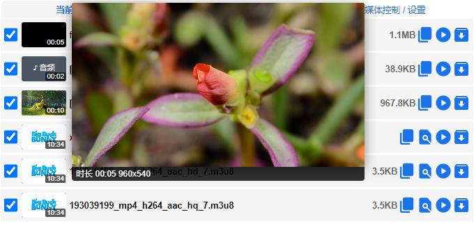
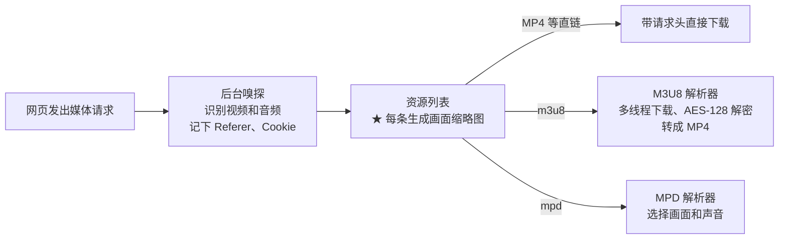
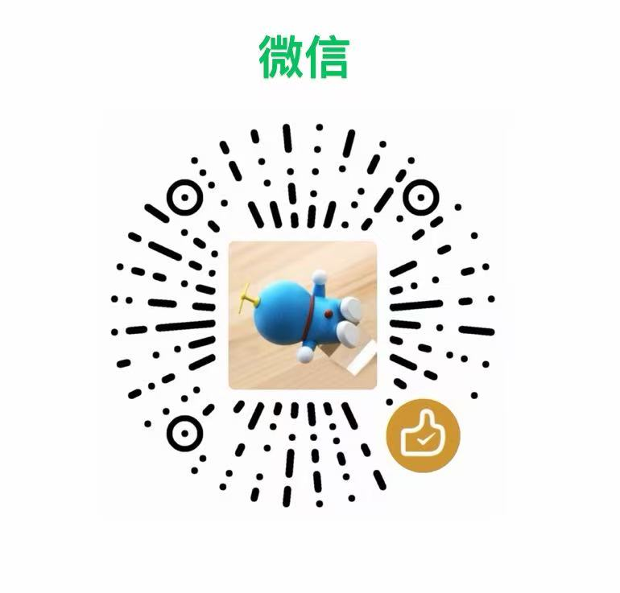

# 视频抓取器 Video Grabber

### 每一条视频，一眼认出来。

**开源、免费的浏览器视频嗅探与下载扩展。** 
列出网页加载的视频和音频，每条都带自己的画面缩略图，看图就知道该下哪一条。

**1.0.0 · 画面缩略图 · m3u8 合并成 MP4 · 自动带上防盗链请求头**

**[下载 1.0.0（633 KB）](https://github.com/huangyu741292/video-grabber/releases/download/v1.0.0/video-grabber-1.0.0.zip) · [安装教程](#下载与安装) · [功能清单](#全部功能清单) · [问题反馈](https://github.com/huangyu741292/video-grabber/issues)**

> 本项目基于开源项目 [cat-catch（猫抓）](https://github.com/xifangczy/cat-catch) 修改，**不是猫抓的官方版本**。使用中遇到问题请到本仓库提 Issue，不要打扰原作者。

  

截图中的画面来自公开测试素材，其中 Big Buck Bunny © Blender Foundation，CC BY 3.0。

## 为什么做这个

打开一个视频网页，嗅探工具往往会列出十几条地址：广告、预告片、不同清晰度，还有画面和声音分开的两个文件。只看文件名和大小，很难知道哪一条才是你要的，只能一条条下载下来试。

**视频抓取器给每一条资源加上它自己的画面缩略图和时长。** 鼠标移上去还能放大看，没有画面的文件单独标成「♪ 音频」。看图挑，挑中了再下载。

## 核心功能

- **画面缩略图**：每条资源加载自身开头附近的一帧，右下角标时长。条目滚动到可视区才加载，同时最多 2 条，不拖慢浏览器。
- **悬停放大**：鼠标移到缩略图上，放大显示画面，并标出时长和分辨率。
- **音频单独标记**：没有画面的文件标「♪ 音频」，方便找到和画面配对的声音。
- **m3u8 下载合并**：解析 HLS 播放列表，多线程下载分片，合并转成 MP4，支持 AES-128 解密和录制直播。
- **带上防盗链请求头**：嗅探时记下网页原本的 Referer、Cookie，下载和生成缩略图时自动带上，避免被网站拦截。

## 使用前请了解

- **列表里不只有正片**：扩展记录的是网页发出的所有媒体请求，没点播放时，页面素材和预加载的视频也会出现在列表里。
- **同一个视频可能有多条**：不同 CDN、不同清晰度会分别列出，目前还不会自动归并。
- **画面和声音可能是两个文件**：抖音、B 站等网站把画面和声音分开存放，只下画面那条会没有声音。需要同时勾选这两条，再用「在线合并」。这个功能依赖第三方页面，见[隐私](#隐私)。
- **只下载你有权下载的视频**，详见[免责声明](#免责声明)。

## 下载与安装

运行环境：**Chrome 104 及以上**。Edge 等 Chromium 内核浏览器理论上也能用。本扩展没有上架应用商店，需要手动加载。

| 下载方式 | 文件 | 大小 |
| --- | --- | --- |
| GitHub Release（推荐） | [video-grabber-1.0.0.zip](https://github.com/huangyu741292/video-grabber/releases/download/v1.0.0/video-grabber-1.0.0.zip) | 633 KB，解压后约 2.3 MB |
| 历史版本 | [全部发布](https://github.com/huangyu741292/video-grabber/releases) | — |
| 源码 | `git clone https://github.com/huangyu741292/video-grabber.git` | 源码文件约 2.6 MB |

1. 下载 zip，解压到一个固定的文件夹。之后不要移动或删除这个文件夹，否则扩展会失效。
2. 打开 `chrome://extensions`，打开右上角的「开发者模式」。
3. 点「加载已解压的扩展程序」，选择解压出来的 `video-grabber-1.0.0` 文件夹。
4. 点工具栏的拼图图标，把紫色的视频抓取器图标固定出来。
5. 打开有视频的网页并开始播放，点图标查看抓到的资源。根据缩略图、时长和大小找到要的那一条，点下载。m3u8 资源会打开解析器页面，完成下载和合并。

**升级方法**：把新版解压后覆盖到原来的文件夹，再到 `chrome://extensions` 点扩展卡片上的刷新按钮。换了文件夹位置的话，扩展 ID 会变，之前的设置不会带过来。

## 全部功能清单

标 ★ 的是本项目新增的功能，其余继承自猫抓。

| 分组 | 功能 |
| --- | --- |
| **资源嗅探** | 按扩展名和 MIME 类型识别视频、音频；支持 MP4、WebM、FLV、MP3、M3U8、MPD 等格式；正则匹配；屏蔽资源和网址；过滤大小；深度搜索；缓存捕捉。 |
| **资源列表** | ★ 画面缩略图和时长、★ 悬停放大、★ 音频标记；当前页面和其他页面分开查看；筛选、排序、显示分组；全选、反选；删除重复文件名；删除无法预览的文件；复制地址；预览播放。 |
| **下载** | 携带请求头下载；内置下载器；自定义保存文件名；下载完选择保存目录；自动下载；调用 aria2、m3u8DL 或本地播放器。 |
| **M3U8 解析器** | 多线程下载；AES-128 解密，自动寻找疑似密钥；选择下载范围；录制直播；边下边存；只要音频；转成 MP4；重下失败项。 |
| **MPD 解析器** | 解析 DASH，分别选择视频和音频，可转为 m3u8 解析。 |
| **媒体控制** | 倍速播放、画中画、全屏、截图、循环、静音。 |
| **录制** | 视频录制、录制 webRTC、屏幕捕捉。 |
| **其他** | 模拟手机；在线合并；发送数据到 MQTT 或自定义地址；导出和导入设置；右键菜单；侧边栏；11 种界面语言。 |

## 工作原理

生成缩略图和下载时，扩展会用浏览器的 `declarativeNetRequest` 把记下的请求头带回去，所以有防盗链的网站也能正常加载。

## 1.0.0 更新重点

- 每条资源显示自己的画面缩略图和时长，悬停放大，纯音频单独标记。
- 使用独立的名称、紫色图标和扩展 ID，可以和猫抓同时安装。
- 安装后不再弹出欢迎页，免责声明和隐私说明移到本页。
- 版本号从 1.0.0 开始，与猫抓的版本号分开。本版本基于猫抓 v2.7.2，改动记录见 [FORK.md](FORK.md)。

## 隐私

抓到的资源信息只保存在你的浏览器本地，扩展不包含跟踪器。以下情况会连接外部地址：

- **缩略图和下载**：扩展会直接向视频所在的网站发请求。
- **「在线合并」和边下边存**：会使用猫抓作者提供的在线页面（`ffmpeg.bmmmd.com`、`ffmpeg.94cat.com`、`stream.bmmmd.com`）。
- **aria2、MQTT、发送数据到自定义地址等功能**：默认关闭，只会连接你自己配置的地址。

## 免责声明

本扩展仅供下载用户拥有版权或已获授权的视频，禁止用于下载受版权保护且未经授权的内容。用户需自行承担使用本工具的全部法律责任，开发者不对用户的任何行为负责。本工具按“原样”提供，开发者不承担任何直接或间接责任。

## 版权保护与拒绝抓取声明

我们尊重网站的内容版权和运营方的合法权益。如果您不允许本工具运行在您的网站上，请在本仓库创建 Issue，标题格式为 `[Opt-Out Request] 您的网站域名`，并在正文写明网站域名和用于核实身份的联系邮箱。收到有效请求后，我们会在后续版本中把该域名加入避免抓取列表。

## 赞赏

如果这个工具帮到了你，欢迎请作者喝杯咖啡。赞赏完全自愿，不赞赏也能使用全部功能。

赞赏归本项目维护者所有。如果想支持猫抓原作者，请前往 [cat-catch](https://github.com/xifangczy/cat-catch) 仓库。

  
  &nbsp;&nbsp;
  

## 致谢

- [cat-catch（猫抓）](https://github.com/xifangczy/cat-catch)：本项目的基础，由 xifangczy 开发
- [hls.js](https://github.com/video-dev/hls.js)
- [jQuery](https://github.com/jquery/jquery)
- [mux.js](https://github.com/videojs/mux.js)
- [jquery.json-viewer](https://github.com/abodelot/jquery.json-viewer)
- [Momo707577045](https://github.com/Momo707577045)
- [mpd-parser](https://github.com/videojs/mpd-parser)
- [StreamSaver.js](https://github.com/jimmywarting/StreamSaver.js)
- [MQTT.js](https://github.com/mqttjs/MQTT.js)

## 许可证

[GPL-3.0](LICENSE)，与猫抓相同。相对上游的改动见 [FORK.md](FORK.md)。

English

### Video Grabber

Video Grabber is a free, open-source browser extension that lists the video and audio resources a page loads and downloads them. Each entry shows its own thumbnail and duration, which enlarges on hover, so you can tell which video is which before downloading. Audio-only files are labeled separately.

It is a modified version of [cat-catch](https://github.com/xifangczy/cat-catch) and is not an official release of that project. It also inherits cat-catch's HLS (m3u8) downloader with multi-threading, AES-128 decryption and MP4 output, the DASH (mpd) parser, and request-header forwarding for hotlink-protected sites.

**Install:** download [video-grabber-1.0.0.zip](https://github.com/huangyu741292/video-grabber/releases/download/v1.0.0/video-grabber-1.0.0.zip) (633 KB), unzip it to a permanent folder, open `chrome://extensions`, turn on Developer mode, and load the unzipped folder. Chrome 104 or later is recommended.

Only download videos you own or are authorized to download. If you find it useful, you can support the maintainer through Alipay or WeChat using the QR codes in the 赞赏 section above. Donations go to this project's maintainer, not to the cat-catch author. Licensed under GPL-3.0.

